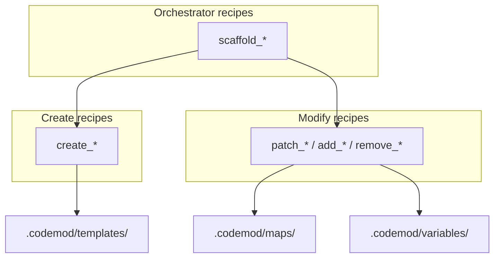

# Recipe Design Patterns (Create vs Modify)

Organize codemod-recipe Luau recipes around **concepts or features**, with a clear
split between **creation** (greenfield scaffolding) and **modification** (brownfield AST
edits).

## Mental model

Think in three layers:

1. **Atomic recipes** — one coherent change (create one file, add one field, remove one member).
2. **Orchestrator recipes** — compose atomics into a feature-level workflow.
3. **Shared assets** — templates, maps, and variables reused across recipes.



**One recipe = one coherent change**, composed upward for features. Host API:
skill `codemod-luau-recipes`.

## Recipe taxonomy

Convey recipe kind through the `id` prefix and `description` — there is no separate
`kind` field.

| Prefix | Purpose | Primary host calls | Typical idempotency |
|--------|---------|-------------------|---------------------|
| `create_` | Generate new files from templates | `c:create` | Fail if file exists (`ifExists = "fail"`) |
| `add_` / `patch_` | Insert or update existing code | `c:insert` / `c:replace` | Varies (see Idempotency) |
| `remove_` | Tear down code or files | `c:remove` or `c:delete` | Safe to re-run when target is gone |
| `scaffold_` | Feature-level workflow | `c:run("child.id", { ... })` (+ optional `c:delete`) | Depends on child recipes |

### `create_<artifact>` — greenfield files

Generate new source when nothing exists yet.

- Use `c:create` with `content` from `c:applyTemplate` or `c:renderFileTemplate`.
- Default `ifExists = "fail"` prevents accidental overwrites.
- Args drive paths and class names (`feature`, `className`).

```lua
c:create({
  path = "lib/counter/counter_repository.dart",
  content = c:renderFileTemplate({ path = "templates/counter_repository.dart.template" }),
  ifExists = "fail",
})
```

### `add_<thing>_to_<target>` / `patch_<target>` — brownfield edits

Insert, replace, or remove AST nodes in existing files.

- Use `c:insert` / `c:replace` / `c:remove` with tree-sitter `query` + `capture`.
- Keep each recipe **atomic**: "add field to state class" is one recipe; "add matching
  handler to bloc" is a separate recipe (or a thin orchestrator that `c:run`s both).
- Args: `file` (or convention-derived path), `className`, domain symbols (`fieldName`,
  `eventName`).

### `scaffold_<feature>` — feature-level orchestrator

Run a "new feature" workflow end-to-end: create files, wire into existing code, optional
cleanup.

- Call children with `c:run("child.id")` or `c:run("child.id", { className = c.args.featureName })`.
- Parent args stay on the parent; pass a table to remap or hardcode child args.

```lua
return {
  id = "scaffold_feature",
  args = {
    { name = "featureName", required = true },
    { name = "fieldName", required = true },
  },
  apply = function(c)
    c:run("create_repository", { className = c.args.featureName })
    c:run("patch_counter", { className = c.args.featureName })
    c:run("patch_app")
    c:delete({ path = "lib/legacy/stale.dart", ifMissing = "skip" })
  end,
}
```

### `remove_<thing>_from_<target>` — teardown

Symmetric counterpart to `add_*`.

- Use `c:remove` for AST members, or `c:delete` for whole files.
- Prefer `ifMissing = "skip"` on file deletes.
- `c:remove` queries that match nothing produce an empty preview (safe re-run).

## Directory layout

Group recipes by **concept** (bloc, repository, routing), not by file type. Adopt
incrementally — flat `recipes/` is fine for small projects.

Dirs under `.codemod/` are **convention only**; the host discovers Luau modules
anywhere under `.codemod/`: recipes (`return { id, apply, ... }`), maps
(`{ id, map = { ... } }`), variables (`{ id, values = { ... } }`).

```text
.codemod/
  recipes/
    bloc/
      scaffold_bloc_feature.luau    # orchestrator
      create_bloc.luau
      create_bloc_state.luau
      add_bloc_state_field.luau
      add_bloc_event_handler.luau
    shared/
      add_class_field.luau          # cross-cutting atomic edits
  maps/
    dart_types.luau                 # fieldName -> Dart type
    bloc_event_kinds.luau
  variables/
    paths.luau                      # shared constants
  templates/
    bloc/
      bloc.dart.template
      bloc_state.dart.template
      bloc_event.dart.template
```

### Naming rules

- Recipe `id` is the stable API (`list_recipes` / `describe_recipe`). Use `snake_case`.
- Prefix encodes kind: `create_`, `add_`, `patch_`, `remove_`, `scaffold_`.
- Maps are keyed by **allowed symbolic names** (not free-form strings).

Example workspace map (`.codemod/maps/field_kind.luau`):

```lua
return {
  id = "field_kind",
  map = {
    tickCount = "int",
    label = "String",
  },
}
```

## Composition pattern

Prefer small, reusable atomics composed by orchestrators:

```lua
-- scaffold_bloc_feature.luau
apply = function(c)
  c:run("create_bloc_state")
  c:run("create_bloc_event")
  c:run("create_bloc")
  c:run("patch_app_routes")
end
```

`c:run` executes the child `apply` with the given args (parent args restored afterward).
Recipe cycles are rejected.

Gate children with Luau `if` / `for` inside `apply` (bool args, `c:queryExists`,
`c:read` via `pcall` for file existence). See skill `codemod-luau-recipes`.

**Same-path incremental ops** are supported via sequential staging: a scaffold may
`c:create` a file (with `ifExists = "skip"`) and then `c:insert` later (or via a
composed `add_*` recipe), or chain dependent edits (class then members). Templates for
greenfield creates must be query-compatible with the following edits.

For incremental changes after scaffolding, call atomic `add_*` recipes directly — do not
re-run the orchestrator unless the orchestrator is intentionally idempotent (`ifExists = "skip"`
plus edits that no-op when already applied).

### Ensure / barrel pattern

```lua
c:create({
  path = "lib/foo/foo.dart",
  content = "// Exports for foo.\n",
  ifExists = "skip",
})
c:insert({
  path = "lib/foo/foo.dart",
  query = "(program) @root",
  capture = "root",
  anchor = "end",
  text = "export 'bar.dart';\n",
})
```

## Maps and templates

**Templates** (`c:renderFileTemplate` / `c:applyTemplate`) hold greenfield skeletons.
Use Jinja2 syntax (MiniJinja): `{{ arg }}`, filters like `{{ feature | pascal_case }}`,
and ``. See skill `codemod-luau-recipes` and [`docs/recipe-templates.md`](../../../docs/recipe-templates.md).

**Maps** resolve symbolic names to types or snippets:

```lua
-- .codemod/maps/dart_types.luau
return {
  id = "dart_types",
  map = {
    email = "String",
    age = "int",
  },
}
```

```lua
local text = c:applyTemplate({
  template = "  final {{ fieldName | map('dart_types') }} {{ fieldName | camel_case }};\n\n",
})
```

Recipe-local `maps = { dart_types = { email = "String" } }` on the return table
merges with registered map modules.

## Args conventions

Use a consistent vocabulary across related recipes:

| Arg | `inputKind` | Used by |
|-----|-------------|---------|
| `file` | `file` | Generic edit recipes |
| `feature` | `text` | Scaffold orchestrators (drives paths via `c:applyTemplate`) |
| `className` | `text` | Class-targeted edits |
| `fieldName` / `eventName` | `text` | Domain names; type resolved via map |
| `fieldType` | optional or map-backed | When not inferable from map |

**Path convention:** pick one style per project and stick to it.

- Scaffolds derive paths from args: `c:applyTemplate({ template = "lib/features/{{ feature | snake_case }}/{{ feature | snake_case }}_state.dart" })`
- Modify recipes take explicit `file`, or use the same path template as scaffolds

## Example: Flutter Bloc feature

Illustrative sketches — not shipped recipes.

| User intent | Recipe kind | What it does |
|-------------|-------------|--------------|
| New Bloc feature | `scaffold_bloc_feature` | Compose `create_bloc`, `create_bloc_state`, `create_bloc_event`, `patch_app_routes` |
| Add state field | `add_bloc_state_field` | Insert field in state class; update `copyWith` / `props` |
| Add event handler | `add_bloc_event_handler` | Insert `on<Event>` handler in bloc class |
| Add event type | `add_bloc_event` | Insert sealed class variant in event file |

Orchestrator sketch:

```lua
return {
  id = "scaffold_bloc_feature",
  description = "Scaffold a new Bloc feature (state, event, bloc files + app wiring)",
  args = {
    { name = "feature", required = true, inputKind = "text" },
  },
  apply = function(c)
    c:run("create_bloc_state")
    c:run("create_bloc_event")
    c:run("create_bloc")
    c:run("patch_app_routes")
  end,
}
```

Atomic modify sketch (state field):

```lua
return {
  id = "add_bloc_state_field",
  description = "Add a typed field to an existing Bloc state class",
  args = {
    { name = "feature", required = true, inputKind = "text" },
    { name = "fieldName", required = true, inputKind = "text" },
  },
  maps = {
    dart_types = { email = "String", count = "int" },
  },
  apply = function(c)
    local path = c:applyTemplate({
      template = "lib/features/{{ feature | snake_case }}/{{ feature | snake_case }}_state.dart",
    })
    local query = c:applyTemplate({
      template = [[
(class_definition
  name: (identifier) @className
  body: (class_body) @body
  (#eq? @className "{{ feature | pascal_case }}State"))
]],
    })
    c:insert({
      path = path,
      query = query,
      capture = "body",
      anchor = "start",
      text = c:applyTemplate({
        template = "  final {{ fieldName | map('dart_types') }} {{ fieldName | camel_case }};\n\n",
      }),
    })
  end,
}
```

**Agent workflow:**

1. `describe_recipe` on `scaffold_bloc_feature` for new features.
2. After scaffolding, use atomic `add_*` recipes for incremental changes.
3. Never guess AST paths — use tree-sitter queries with explicit captures.

## Example: Database tables (conceptual)

The same taxonomy applies when schema lives in Dart (Drift, Floor, Isar) or when
you set `language` on ops for `.sql` files (`codemod-languages`).

| User intent | Recipe kind | Notes |
|-------------|-------------|-------|
| New table | `create_table_users` or `scaffold_drift_table` | `c:create` with table template |
| Add column | `add_column_users_email` | `c:insert` targeting the table definition |
| Remove column | `remove_column_users_email` | `c:remove` on the field member |

## Idempotency

Agents should always: `preview_recipe` → `apply_recipe` → re-preview.

| Kind | Expected behavior | How |
|------|-------------------|-----|
| `create_*` | Fail if exists | `ifExists = "fail"` (default) |
| `add_*` (insert) | Often **not** idempotent | Guard with `if not c:queryExists(...)` or accept preview failure on re-run |
| `replace_*` | Idempotent | `c:replace` with final desired text |
| `remove_*` | Idempotent | `c:remove` when gone → empty preview |

Plan for non-idempotent `add_*` recipes and document that in the recipe `description`.

After apply, re-run `preview_recipe` — expect `files: []` for idempotent recipes.

## Related skills

- `codemod-luau-recipes` — host API, templates, maps
- `codemod-recipe-authoring` — tree-sitter queries
- `recipe-generation` — generate recipes from `@` code refs
- `codemod-mcp-playbook` — preview/apply workflow
