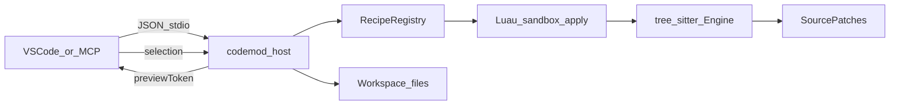

# Architecture

codemod_recipe applies deterministic file changes from **sandboxed Luau recipes**.
The runtime is implemented in Rust; agents and the VS Code extension talk to the same
host protocol.

## Components

| Component | Location | Role |
|-----------|----------|------|
| Luau loader + model | `rust/crates/lua/` | Parse/validate recipe modules, maps, variables, query libs |
| Luau runtime | `rust/crates/host/src/lua_runtime.rs` | Sandboxed `apply(c)` execution, host API |
| Tree-sitter engine | `rust/crates/engine/` | Query evaluation, insert/replace/remove |
| Core types | `rust/crates/core/` | Patches, file changes, atomic apply, path resolution |
| Host + MCP | `rust/crates/host/` | Registry, preview/apply/diff, bootstrap, `codemod_mcp` |
| VS Code extension | `vscode_extension/` | UI, spawns bundled `codemod_host`, Files + Transcript review |
| Shipped recipes | `.codemod/recipes/` | Example Luau modules |

## Data flow



## Design principles

1. **Determinism** — Same recipe + args + file contents produce the same patches.
2. **Preview before apply** — Host returns a `previewToken`; apply requires it and optional per-patch selection.
3. **Single mutation entrypoint** — All edits flow through `apply(c)`; no declarative YAML step lists.
4. **Tree-sitter queries** — Edits target AST nodes via captures.
5. **Multi-language** — `language` on edit ops (or extension inference) selects grammars.

## Recipes

Recipes are Luau modules:

```lua
return {
  id = "my.recipe",
  args = { ... },
  apply = function(c) ... end,
  postExecution = { "dart format ." },  -- optional
}
```

- **Preview** runs `apply()` against a WorkingTree; postExec is transcript-only.
- **Apply** re-runs `apply()`, flushes to disk, then runs postExec / postExecution.
- **Transcript** records every host call for review/debug.
- **MiniJinja** remains for `c:applyTemplate` / `c:renderFileTemplate`.

See skill `codemod-luau-recipes` and `docs/writing-recipes.md`.

## Assets

| Asset | Format | Location |
|-------|--------|----------|
| Recipes | Luau module | `.codemod/recipes/*.luau` |
| Maps | Luau module | `.codemod/maps/*.luau` |
| Variables | Luau module | `.codemod/variables/*.luau` |
| Query libs | Luau module | `.codemod/queries/*.luau` |
| Queries | `.scm` or inline string | recipe-local or `.codemod/` |

## Testing

- Unit and integration tests: `rust/` (`cargo test --all`).
- Golden Dart fixtures: `test/fixtures/rust_oracle/`, `test/fixtures/ast_paths/`.
- Luau recipe fixtures: `test/fixtures/**/*.luau`, `.codemod/recipes/*.luau`.

## Extension

The extension bundles `codemod_host` from `vscode_extension/build.sh`. Message types are
shared in `vscode_extension/src/shared/messages.ts`; the host protocol is implemented in
`rust/crates/host/src/protocol/dispatch.rs`.

The review panel exposes **Files** (diffs) and **Transcript** (host call log). When
preview skipped postExec, apply may diverge — surfaced as `applyMayDiverge`.

## Recipe runtime

Recipes are sandboxed Luau modules (`rust/crates/lua`, `rust/crates/host/src/lua_runtime.rs`).
Mutations happen only in `apply(c)`. MiniJinja is used via `c:applyTemplate` /
`c:renderFileTemplate`. Host API detail: skill `codemod-luau-recipes`.
