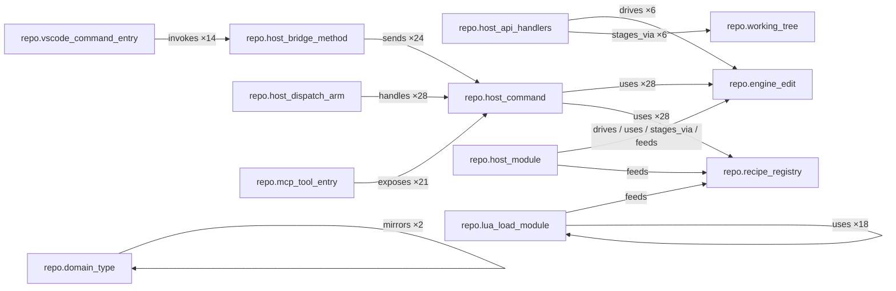

# Architecture graph

Committed view of the self-hosting `repo-stack` relation graph: how VS Code
commands, host-bridge methods, MCP tools, and `HostCommand` variants connect.
Generated from a live component scan (0 findings).

Companion artifacts in this folder:

- [`_kinds.mmd`](_kinds.mmd) — kind-level mermaid (also embedded below)
- [`_instances.mmd`](_instances.mmd) — instance-level mermaid (also embedded below)

Machine snapshot: `{codemod_root}/.cache/scan-snapshot.json` (see
[Target architecture](05_target_architecture.md)).

## Kind graph

Component-level roll-up (edge counts). This is the architecture diagram:



Reading the graph:

- **Command triangle:** vscode **invokes** bridge → **sends** HostCommand; MCP **exposes** the same commands; dispatch **handles** them
- **Domain internals (D-025):** `host_api_handlers` / `host_module` **drive** / **use** `engine_edit` and **stage_via** `working_tree`; `lua_load_module` **feeds** `recipe_registry`

There is no junction `repo.command` node — the command concept lives in these
edges plus stack `createCommand` fan-out (see [Decisions](03_decisions.md)).

Machine SSOT for the full roll-up: [`.codemod/.cache/kind-graph.mmd`](../../../.codemod/.cache/kind-graph.mmd).

## Instance graph

Every identified instance and relation edge. Dense; useful for debugging
completeness gaps, not for casual reading.

```mermaid
graph LR
  repo_rust_crate_core["repo.rust_crate/core"]
  repo_rust_crate_engine["repo.rust_crate/engine"]
  repo_rust_crate_host["repo.rust_crate/host"]
  repo_rust_crate_lua["repo.rust_crate/lua"]
  repo_rust_crate_lua_macros["repo.rust_crate/lua_macros"]
  repo_rust_crate_query_tools["repo.rust_crate/query_tools"]
  repo_host_protocol_host_protocol["repo.host_protocol/host-protocol"]
  repo_host_command_list["repo.host_command/list"]
  repo_host_command_reload["repo.host_command/reload"]
  repo_host_command_validate["repo.host_command/validate"]
  repo_host_command_describe["repo.host_command/describe"]
  repo_host_command_preview["repo.host_command/preview"]
  repo_host_command_apply["repo.host_command/apply"]
  repo_host_command_diff["repo.host_command/diff"]
  repo_host_command_generateAstPath["repo.host_command/generateAstPath"]
  repo_host_command_bootstrap["repo.host_command/bootstrap"]
  repo_host_command_deriveArgs["repo.host_command/deriveArgs"]
  repo_host_command_filterExplorerRecipes["repo.host_command/filterExplorerRecipes"]
  repo_host_command_dumpAst["repo.host_command/dumpAst"]
  repo_host_command_debugQuery["repo.host_command/debugQuery"]
  repo_host_command_generateQuery["repo.host_command/generateQuery"]
  repo_host_command_resolveStaticPath["repo.host_command/resolveStaticPath"]
  repo_host_command_queryCaptures["repo.host_command/queryCaptures"]
  repo_host_command_componentScan["repo.host_command/componentScan"]
  repo_host_command_componentIncrementalScan["repo.host_command/componentIncrementalScan"]
  repo_host_command_componentListInstances["repo.host_command/componentListInstances"]
  repo_host_command_componentCoverage["repo.host_command/componentCoverage"]
  repo_host_command_componentGraph["repo.host_command/componentGraph"]
  repo_host_command_componentInvokeOperation["repo.host_command/componentInvokeOperation"]
  repo_host_command_componentScaffold["repo.host_command/componentScaffold"]
  repo_host_command_componentInvokeHook["repo.host_command/componentInvokeHook"]
  repo_host_command_describeComponent["repo.host_command/describeComponent"]
  repo_host_command_stackInvokeOperation["repo.host_command/stackInvokeOperation"]
  repo_host_command_runTests["repo.host_command/runTests"]
  repo_host_command_componentSnapshot["repo.host_command/componentSnapshot"]
  repo_mcp_tool_mcp_surface["repo.mcp_tool/mcp-surface"]
  repo_mcp_tool_entry_list_recipes["repo.mcp_tool_entry/list_recipes"]
  repo_mcp_tool_entry_describe_recipe["repo.mcp_tool_entry/describe_recipe"]
  repo_mcp_tool_entry_validate_recipes["repo.mcp_tool_entry/validate_recipes"]
  repo_mcp_tool_entry_preview_recipe["repo.mcp_tool_entry/preview_recipe"]
  repo_mcp_tool_entry_apply_recipe["repo.mcp_tool_entry/apply_recipe"]
  repo_mcp_tool_entry_bootstrap_project["repo.mcp_tool_entry/bootstrap_project"]
  repo_mcp_tool_entry_dump_ast["repo.mcp_tool_entry/dump_ast"]
  repo_mcp_tool_entry_debug_query["repo.mcp_tool_entry/debug_query"]
  repo_mcp_tool_entry_generate_query["repo.mcp_tool_entry/generate_query"]
  repo_mcp_tool_entry_resolve_static_path["repo.mcp_tool_entry/resolve_static_path"]
  repo_mcp_tool_entry_component_scan["repo.mcp_tool_entry/component_scan"]
  repo_mcp_tool_entry_component_incremental_scan["repo.mcp_tool_entry/component_incremental_scan"]
  repo_mcp_tool_entry_list_component_instances["repo.mcp_tool_entry/list_component_instances"]
  repo_mcp_tool_entry_component_coverage["repo.mcp_tool_entry/component_coverage"]
  repo_mcp_tool_entry_component_graph["repo.mcp_tool_entry/component_graph"]
  repo_mcp_tool_entry_component_snapshot["repo.mcp_tool_entry/component_snapshot"]
  repo_mcp_tool_entry_describe_component["repo.mcp_tool_entry/describe_component"]
  repo_mcp_tool_entry_component_dry_run_hook["repo.mcp_tool_entry/component_dry_run_hook"]
  repo_mcp_tool_entry_component_apply_hook["repo.mcp_tool_entry/component_apply_hook"]
  repo_mcp_tool_entry_stack_dry_run_operation["repo.mcp_tool_entry/stack_dry_run_operation"]
  repo_mcp_tool_entry_stack_apply_operation["repo.mcp_tool_entry/stack_apply_operation"]
  repo_mcp_tool_entry_run_tests["repo.mcp_tool_entry/run_tests"]
  repo_host_bridge_host_bridge["repo.host_bridge/host-bridge"]
  repo_host_bridge_method_constructor["repo.host_bridge_method/constructor"]
  repo_host_bridge_method_workspaceRoot["repo.host_bridge_method/workspaceRoot"]
  repo_host_bridge_method_getBinaryPath["repo.host_bridge_method/getBinaryPath"]
  repo_host_bridge_method_hasBundledBinary["repo.host_bridge_method/hasBundledBinary"]
  repo_host_bridge_method_getSpawnCommand["repo.host_bridge_method/getSpawnCommand"]
  repo_host_bridge_method_listRecipes["repo.host_bridge_method/listRecipes"]
  repo_host_bridge_method_reloadRecipes["repo.host_bridge_method/reloadRecipes"]
  repo_host_bridge_method_validateRecipes["repo.host_bridge_method/validateRecipes"]
  repo_host_bridge_method_ensureHost["repo.host_bridge_method/ensureHost"]
  repo_host_bridge_method_describe["repo.host_bridge_method/describe"]
  repo_host_bridge_method_preview["repo.host_bridge_method/preview"]
  repo_host_bridge_method_diff["repo.host_bridge_method/diff"]
  repo_host_bridge_method_apply["repo.host_bridge_method/apply"]
  repo_host_bridge_method_deriveArgs["repo.host_bridge_method/deriveArgs"]
  repo_host_bridge_method_filterExplorerRecipes["repo.host_bridge_method/filterExplorerRecipes"]
  repo_host_bridge_method_bootstrapProject["repo.host_bridge_method/bootstrapProject"]
  repo_host_bridge_method_dumpAst["repo.host_bridge_method/dumpAst"]
  repo_host_bridge_method_debugQuery["repo.host_bridge_method/debugQuery"]
  repo_host_bridge_method_generateQuery["repo.host_bridge_method/generateQuery"]
  repo_host_bridge_method_resolveStaticPath["repo.host_bridge_method/resolveStaticPath"]
  repo_host_bridge_method_queryCaptures["repo.host_bridge_method/queryCaptures"]
  repo_host_bridge_method_componentScan["repo.host_bridge_method/componentScan"]
  repo_host_bridge_method_runTests["repo.host_bridge_method/runTests"]
  repo_host_bridge_method_componentCoverage["repo.host_bridge_method/componentCoverage"]
  repo_host_bridge_method_componentIncrementalScan["repo.host_bridge_method/componentIncrementalScan"]
  repo_host_bridge_method_describeComponent["repo.host_bridge_method/describeComponent"]
  repo_host_bridge_method_componentScaffold["repo.host_bridge_method/componentScaffold"]
  repo_host_bridge_method_componentInvokeOperation["repo.host_bridge_method/componentInvokeOperation"]
  repo_host_bridge_method_componentInvokeHook["repo.host_bridge_method/componentInvokeHook"]
  repo_host_bridge_method_stackInvokeOperation["repo.host_bridge_method/stackInvokeOperation"]
  repo_host_bridge_method_dispose["repo.host_bridge_method/dispose"]
  repo_host_bridge_method_cancelInFlight["repo.host_bridge_method/cancelInFlight"]
  repo_host_bridge_method_parseRecipeLoadResponse["repo.host_bridge_method/parseRecipeLoadResponse"]
  repo_host_bridge_method_currentHostSpawnConfig["repo.host_bridge_method/currentHostSpawnConfig"]
  repo_host_bridge_method_ensureHostConfigCurrent["repo.host_bridge_method/ensureHostConfigCurrent"]
  repo_host_bridge_method_send["repo.host_bridge_method/send"]
  repo_host_bridge_method_sendPersistent["repo.host_bridge_method/sendPersistent"]
  repo_host_bridge_method_ensurePersistentHost["repo.host_bridge_method/ensurePersistentHost"]
  repo_host_bridge_method_flushFrames["repo.host_bridge_method/flushFrames"]
  repo_host_bridge_method_sendOneShot["repo.host_bridge_method/sendOneShot"]
  repo_host_bridge_method_stopPersistentHost["repo.host_bridge_method/stopPersistentHost"]
  repo_host_bridge_method_rejectPending["repo.host_bridge_method/rejectPending"]
  repo_host_bridge_method_logPerf["repo.host_bridge_method/logPerf"]
  repo_host_bridge_method_logPerfWarning["repo.host_bridge_method/logPerfWarning"]
  repo_vscode_command_vscode_commands["repo.vscode_command/vscode-commands"]
  repo_vscode_command_entry_codemodRecipe_refresh["repo.vscode_command_entry/codemodRecipe.refresh"]
  repo_vscode_command_entry_codemodRecipe_bootstrap["repo.vscode_command_entry/codemodRecipe.bootstrap"]
  repo_vscode_command_entry_codemodRecipe_scaffoldProject["repo.vscode_command_entry/codemodRecipe.scaffoldProject"]
  repo_vscode_command_entry_codemodRecipe_updateProjectScaffold["repo.vscode_command_entry/codemodRecipe.updateProjectScaffold"]
  repo_vscode_command_entry_codemodRecipe_runRecipe["repo.vscode_command_entry/codemodRecipe.runRecipe"]
  repo_vscode_command_entry_codemodRecipe_runFromCursorContext["repo.vscode_command_entry/codemodRecipe.runFromCursorContext"]
  repo_vscode_command_entry_codemodRecipe_runFromExplorer["repo.vscode_command_entry/codemodRecipe.runFromExplorer"]
  repo_vscode_command_entry_codemodRecipe_openFromExplorer["repo.vscode_command_entry/codemodRecipe.openFromExplorer"]
  repo_vscode_command_entry_codemodRecipe_invoke["repo.vscode_command_entry/codemodRecipe.invoke"]
  repo_vscode_command_entry_codemodRecipe_invokeSlot["repo.vscode_command_entry/codemodRecipe.invokeSlot"]
  repo_vscode_command_entry_codemodRecipe_copyInvokeKeybinding["repo.vscode_command_entry/codemodRecipe.copyInvokeKeybinding"]
  repo_vscode_command_entry_codemodRecipe_assignToSlot["repo.vscode_command_entry/codemodRecipe.assignToSlot"]
  repo_vscode_command_entry_codemodRecipe_copySlotKeybinding["repo.vscode_command_entry/codemodRecipe.copySlotKeybinding"]
  repo_vscode_command_entry_codemodRecipe_configureHost["repo.vscode_command_entry/codemodRecipe.configureHost"]
  repo_vscode_command_entry_codemodRecipe_validateRecipes["repo.vscode_command_entry/codemodRecipe.validateRecipes"]
  repo_vscode_command_entry_codemodRecipe_runTests["repo.vscode_command_entry/codemodRecipe.runTests"]
  repo_vscode_command_entry_codemodRecipe_openInRecipeRunner["repo.vscode_command_entry/codemodRecipe.openInRecipeRunner"]
  repo_vscode_command_entry_codemodRecipe_testQueryOnFile["repo.vscode_command_entry/codemodRecipe.testQueryOnFile"]
  repo_vscode_command_entry_codemodRecipe_queryTools_run["repo.vscode_command_entry/codemodRecipe.queryTools.run"]
  repo_vscode_command_entry_codemodRecipe_queryTools_generateFromCursor["repo.vscode_command_entry/codemodRecipe.queryTools.generateFromCursor"]
  repo_vscode_command_entry_codemodRecipe_queryTools_revealAst["repo.vscode_command_entry/codemodRecipe.queryTools.revealAst"]
  repo_vscode_command_entry_codemodRecipe_queryTools_nextMatch["repo.vscode_command_entry/codemodRecipe.queryTools.nextMatch"]
  repo_vscode_command_entry_codemodRecipe_queryTools_prevMatch["repo.vscode_command_entry/codemodRecipe.queryTools.prevMatch"]
  repo_vscode_command_entry_codemodRecipe_queryTools_copy["repo.vscode_command_entry/codemodRecipe.queryTools.copy"]
  repo_vscode_command_entry_codemodRecipe_queryTools_copyYaml_insert["repo.vscode_command_entry/codemodRecipe.queryTools.copyYaml.insert"]
  repo_vscode_command_entry_codemodRecipe_queryTools_copyYaml_replace["repo.vscode_command_entry/codemodRecipe.queryTools.copyYaml.replace"]
  repo_vscode_command_entry_codemodRecipe_queryTools_copyYaml_remove["repo.vscode_command_entry/codemodRecipe.queryTools.copyYaml.remove"]
  repo_vscode_command_entry_codemodRecipe_queryTools_openFromRecipe["repo.vscode_command_entry/codemodRecipe.queryTools.openFromRecipe"]
  repo_vscode_command_entry_codemodRecipe_queryTools_goToEditPath["repo.vscode_command_entry/codemodRecipe.queryTools.goToEditPath"]
  repo_vscode_command_entry_codemodRecipe_queryTools_selectAstNode["repo.vscode_command_entry/codemodRecipe.queryTools.selectAstNode"]
  repo_vscode_command_entry_codemodRecipe_queryTools_astDisplayMode["repo.vscode_command_entry/codemodRecipe.queryTools.astDisplayMode"]
  repo_host_bridge_method_listRecipes -- "sends" --> repo_host_command_list
  repo_host_bridge_method_reloadRecipes -- "sends" --> repo_host_command_reload
  repo_host_bridge_method_validateRecipes -- "sends" --> repo_host_command_validate
  repo_host_bridge_method_describe -- "sends" --> repo_host_command_describe
  repo_host_bridge_method_preview -- "sends" --> repo_host_command_preview
  repo_host_bridge_method_diff -- "sends" --> repo_host_command_diff
  repo_host_bridge_method_apply -- "sends" --> repo_host_command_apply
  repo_host_bridge_method_deriveArgs -- "sends" --> repo_host_command_deriveArgs
  repo_host_bridge_method_filterExplorerRecipes -- "sends" --> repo_host_command_filterExplorerRecipes
  repo_host_bridge_method_bootstrapProject -- "sends" --> repo_host_command_bootstrap
  repo_host_bridge_method_dumpAst -- "sends" --> repo_host_command_dumpAst
  repo_host_bridge_method_debugQuery -- "sends" --> repo_host_command_debugQuery
  repo_host_bridge_method_generateQuery -- "sends" --> repo_host_command_generateQuery
  repo_host_bridge_method_resolveStaticPath -- "sends" --> repo_host_command_resolveStaticPath
  repo_host_bridge_method_queryCaptures -- "sends" --> repo_host_command_queryCaptures
  repo_host_bridge_method_componentScan -- "sends" --> repo_host_command_componentScan
  repo_host_bridge_method_runTests -- "sends" --> repo_host_command_runTests
  repo_host_bridge_method_componentCoverage -- "sends" --> repo_host_command_componentCoverage
  repo_host_bridge_method_componentIncrementalScan -- "sends" --> repo_host_command_componentIncrementalScan
  repo_host_bridge_method_describeComponent -- "sends" --> repo_host_command_describeComponent
  repo_host_bridge_method_componentScaffold -- "sends" --> repo_host_command_componentScaffold
  repo_host_bridge_method_componentInvokeOperation -- "sends" --> repo_host_command_componentInvokeOperation
  repo_host_bridge_method_componentInvokeHook -- "sends" --> repo_host_command_componentInvokeHook
  repo_host_bridge_method_stackInvokeOperation -- "sends" --> repo_host_command_stackInvokeOperation
  repo_mcp_tool_entry_list_recipes -- "exposes" --> repo_host_command_list
  repo_mcp_tool_entry_describe_recipe -- "exposes" --> repo_host_command_describe
  repo_mcp_tool_entry_validate_recipes -- "exposes" --> repo_host_command_validate
  repo_mcp_tool_entry_preview_recipe -- "exposes" --> repo_host_command_preview
  repo_mcp_tool_entry_apply_recipe -- "exposes" --> repo_host_command_apply
  repo_mcp_tool_entry_dump_ast -- "exposes" --> repo_host_command_dumpAst
  repo_mcp_tool_entry_debug_query -- "exposes" --> repo_host_command_debugQuery
  repo_mcp_tool_entry_generate_query -- "exposes" --> repo_host_command_generateQuery
  repo_mcp_tool_entry_resolve_static_path -- "exposes" --> repo_host_command_resolveStaticPath
  repo_mcp_tool_entry_component_scan -- "exposes" --> repo_host_command_componentScan
  repo_mcp_tool_entry_component_incremental_scan -- "exposes" --> repo_host_command_componentIncrementalScan
  repo_mcp_tool_entry_list_component_instances -- "exposes" --> repo_host_command_componentListInstances
  repo_mcp_tool_entry_component_coverage -- "exposes" --> repo_host_command_componentCoverage
  repo_mcp_tool_entry_component_graph -- "exposes" --> repo_host_command_componentGraph
  repo_mcp_tool_entry_component_snapshot -- "exposes" --> repo_host_command_componentSnapshot
  repo_mcp_tool_entry_describe_component -- "exposes" --> repo_host_command_describeComponent
  repo_mcp_tool_entry_component_dry_run_hook -- "exposes" --> repo_host_command_componentInvokeHook
  repo_mcp_tool_entry_component_apply_hook -- "exposes" --> repo_host_command_componentInvokeHook
  repo_mcp_tool_entry_stack_dry_run_operation -- "exposes" --> repo_host_command_stackInvokeOperation
  repo_mcp_tool_entry_stack_apply_operation -- "exposes" --> repo_host_command_stackInvokeOperation
  repo_mcp_tool_entry_run_tests -- "exposes" --> repo_host_command_runTests
  repo_vscode_command_entry_codemodRecipe_configureHost -- "invokes" --> repo_host_bridge_method_dispose
  repo_vscode_command_entry_codemodRecipe_validateRecipes -- "invokes" --> repo_host_bridge_method_ensureHost
  repo_vscode_command_entry_codemodRecipe_validateRecipes -- "invokes" --> repo_host_bridge_method_validateRecipes
  repo_vscode_command_entry_codemodRecipe_runTests -- "invokes" --> repo_host_bridge_method_ensureHost
  repo_vscode_command_entry_codemodRecipe_queryTools_run -- "invokes" --> repo_host_bridge_method_debugQuery
  repo_vscode_command_entry_codemodRecipe_queryTools_run -- "invokes" --> repo_host_bridge_method_dumpAst
  repo_vscode_command_entry_codemodRecipe_queryTools_generateFromCursor -- "invokes" --> repo_host_bridge_method_dumpAst
  repo_vscode_command_entry_codemodRecipe_queryTools_generateFromCursor -- "invokes" --> repo_host_bridge_method_generateQuery
  repo_vscode_command_entry_codemodRecipe_queryTools_revealAst -- "invokes" --> repo_host_bridge_method_dumpAst
  repo_vscode_command_entry_codemodRecipe_queryTools_revealAst -- "invokes" --> repo_host_bridge_method_generateQuery
  repo_vscode_command_entry_codemodRecipe_queryTools_openFromRecipe -- "invokes" --> repo_host_bridge_method_debugQuery
  repo_vscode_command_entry_codemodRecipe_queryTools_openFromRecipe -- "invokes" --> repo_host_bridge_method_dumpAst
  repo_vscode_command_entry_codemodRecipe_queryTools_openFromRecipe -- "invokes" --> repo_host_bridge_method_resolveStaticPath
  repo_vscode_command_entry_codemodRecipe_queryTools_goToEditPath -- "invokes" --> repo_host_bridge_method_resolveStaticPath
  repo_vscode_command_entry_codemodRecipe_queryTools_selectAstNode -- "invokes" --> repo_host_bridge_method_generateQuery
```

## Snapshot

Machine scan dump and mermaid live under `{codemod_root}/.cache/`:

- `scan-snapshot.json` — instances, edges, kindGraph, findings (+ meta); when
  `stack.codebase` is set, also compact `coverage` (aggregate + per-file ratios,
  no gap ranges); always includes `relations` (connectivity + zone-role metrics:
  `relationIgnored`, architecture ratios)
- `scan-snapshot.json` — ordered `meta`, `coverage`, `relations`, then
  instances/edges/kindGraph/findings (content-stable rewrite)
- `kind-graph.mmd` — architecture roll-up (read first)
- `instance-graph.mmd` — **complete** instance + membership map

`component_scan` / `component_snapshot` refresh all three (content-stable).
Live `component_coverage` still returns full per-file `gaps` for the UI.
See [Target architecture](05_target_architecture.md). Human copies of the
mermaid can still be embedded here for mdBook; the cache is the machine SSOT.

## Regenerating

From a workspace with `.cursor/mcp.json` pointing at `codemod_mcp` (or drive
the same JSON-RPC over stdio):

1. `component_scan` (refreshes `{codemod_root}/.cache/scan-snapshot.json`,
   `kind-graph.mmd`, and `instance-graph.mmd`)
2. Optionally copy `.cache/*.mmd` into this folder / embed in the fenced blocks
   above for mdBook
3. Or `component_graph` with `out:` under `docs/develop/05_dogfood/` if you want
   workspace-relative exports without reading the cache

`component_graph` `out` is workspace-relative. Snapshot `path` (optional) is
codemod-root-relative; both reject `..` traversal outside their root.
