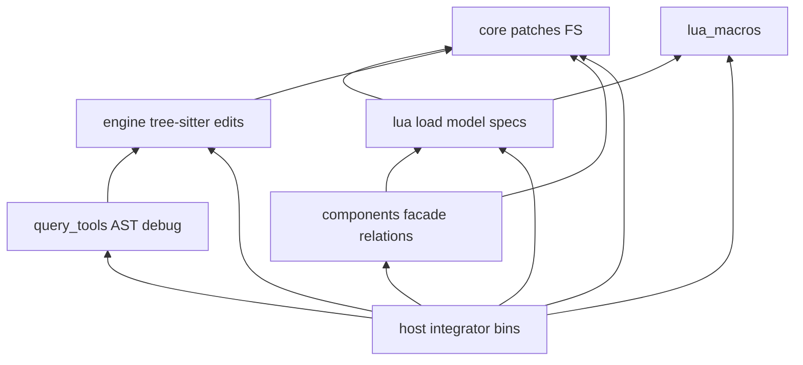
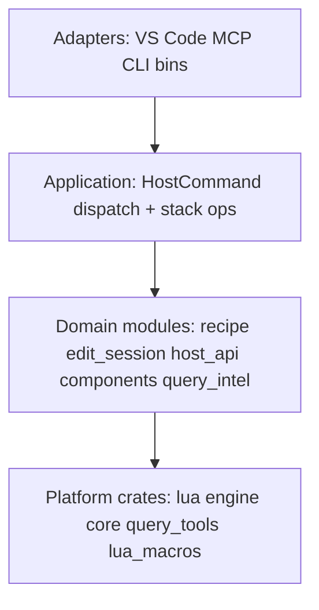
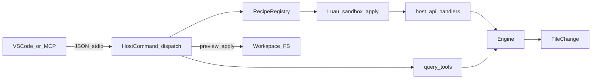
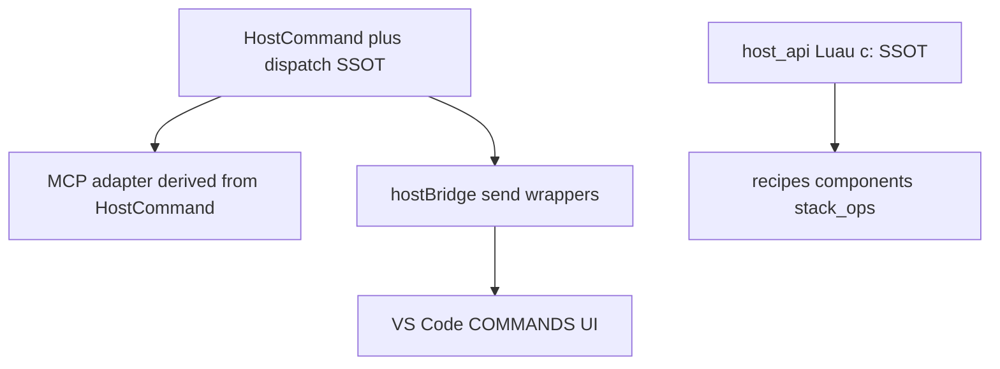

# Target architecture (expected vs scan)

Full-system **expected** architecture for this repository. Dogfood components
should judge against this picture and emit findings when reality diverges —
not greenwash today’s duplicates as “in sync.”

Companion views:

- [Architecture graph](04_architecture_graph.md) — command-triangle kind/instance
  mermaid from a live scan
- [ARCHITECTURE.md](../../../ARCHITECTURE.md) — product overview for all readers;
  this page is the maintainer **policy** for expected layering and smells
- [Decisions](03_decisions.md) — Phase 2 calls (stack ops, no junction)

Codemod root means `--codemod-root` / VS Code `codemodRoot` (default
`<workspace>/.codemod`), not a hardcoded folder name.

## Crate DAG (intended)

| Crate | Role (policy) |
|-------|----------------|
| `codemod_recipe_lua_macros` | Proc macros for `#[host_method]` / `LuaSpec` — keep runtime + stubs aligned |
| `codemod_recipe_core` | Disk patches / atomic apply — no tree-sitter, no recipes |
| `codemod_recipe_lua` | Load/validate Luau assets + Luau-facing specs — may depend on `core` (D-016 shared shapes); **must not** depend on `engine` |
| `codemod_recipe_engine` | Grammars, queries, edit ops — **must not** know recipes/registry |
| `codemod_recipe_query_tools` | AST dump / debug / generate — recipe-free; depends on `engine` only |
| `codemod_recipe_components` | `ComponentHost` facade, relations/types/graph (D-025 F); **must not** import `SharedHost` |
| `codemod_recipe_host` | Integrator: protocol, registry, Luau scan/runtime entry, WorkingTree, bootstrap, bins |

**Forbidden** (expected findings if violated): `lua → engine`, `engine → lua`,
`engine → host`, `query_tools → host` / recipe coupling, new crates that bypass
this DAG without an explicit decision.

Enforced by: `repo.rust_crate` path-dep DAG check (Phase 3).

## Host domain modules (intended)

Module-first grain; `components` extracted ([D-025 F](03_decisions.md#host-facade-then-crate-extract-d-025-f)).

| Domain id | Path (target) | Owns | Does not own |
|-----------|---------------|------|--------------|
| `recipe` | `host/src/recipe/` | Registry, args, validate, derive | Asset parse (lua), disk apply |
| `edit_session` | `host/src/edit_session/` (was `engine/`) | WorkingTree, preview/apply orchestration, postExec | tree-sitter Engine, FileChange impl |
| `host_api` | `host/src/host_api/` | `c:*` methods, SharedHost, registry | Spec types in core/lua (D-016) |
| `components` | `crates/components` + host `component/{entry,runtime,scan,…}` | Facade, relations, types (crate); Luau scan/ops entry (host) | Protocol adapters |
| `query_intel` | `host/src/query/` | Host wrappers over query_tools + AST cache | Grammar / compile (engine) |
| `protocol` | `host/src/protocol/` | HostCommand schemas, dispatch, mcp_inventory | Handler business logic beyond routing |
| `sandbox` | `host/src/sandbox/` | PathSandbox, globs, path templates | |
| `config` | `host/src/config/` | HostConfig, bootstrap | |
| `template` | `host/src/template/` | MiniJinja for `c:template` | |

### Lua load modules (intended)

`lua/src/load.rs` splits by asset kind: `load/{mod,recipe,map,variables,query_lib,type_def,component,stack,test_suite,table_util}.rs`.
Public API (`load_recipe`, `load_asset`, …) stays stable.

### Architecture layers (vocabulary)

## Runtime data flow (intended)

Principles: determinism; preview before apply; single mutation entry via
`apply(c, args)` / component hooks; tree-sitter targeting.

## Clients and command adapters

- `HostCommand` and `host_api` are **two different cores** (RPC vs in-sandbox),
  not mirrors of each other.
- MCP / TS union / bridge are **adapters** of `HostCommand`.
- Completeness = `exposes` / `sends` / `invokes` + stack `createCommand`
  (no junction `repo.command` — see [Decisions](03_decisions.md)).
- **Logical domain units** (`repo.engine_edit`, `repo.working_tree`,
  `repo.recipe_registry`, `repo.domain_type`, `repo.webview_message`) model
  runtime architecture at the same grain as `repo.host_command` — not Cargo
  packages. `repo.rust_crate` remains packaging hygiene only.
- Stack `relations` registry: `layout = "edge"` (arrows) vs `layout = "member"`
  (`lives_in` → opaque-string subgraphs in instance mermaid; multi-parent/cycle
  → `relation.multi_membership` / `relation.membership_cycle`).

### Adapter matrix policy (H / B / M / V)

Every `HostCommand` must have dispatch **handles** (H). Other adapters are
**policy**, not “must be 100%”:

| Letter | Edge | Meaning |
|--------|------|---------|
| H | `handles` | Dispatch arm — required for every variant |
| B | `sends` | `hostBridge` method sends this command |
| M | `exposes` | MCP tool exposes this command |
| V | `invokes` | VS Code `registerCommand(COMMANDS.x, …)` one-hop to a bridge method |

**Intentional asymmetry (do not “fix” by stuffing adapters):**

- **No M** — VS Code / scaffold / explorer-only: e.g. `bootstrap`, `diff`,
  `deriveArgs`, `reload`, `filterExplorerRecipes`, `componentScaffold`,
  `componentInvokeOperation`, `queryCaptures`.
- **No B** — MCP/intel-oriented (no hostBridge wrapper): e.g.
  `componentGraph`, `componentListInstances`, `componentSnapshot`.
- **V under-counts UI** — many COMMANDS are multi-hop (`invoke` →
  `recipeInvoke` → bridge). Graph `invokes` is **one-hop only**. UI commands may
  only `presents` a zone; HostCommand coverage is judged via **B/M**, not V.
  Do not treat missing V as a product smell unless the handler literally never
  reaches the host.

**Smell:** a HostCommand with **neither B nor M** and no documented INTERNAL
reason (retired stub). Example fixed: `generateAstPath` (unsupported v1 stub)
was removed from the SSOT rather than leave a zombie node.

**Overlapping host_api composers (roles, not duplicates):**

| Composer | Role |
|----------|------|
| `repo.host_api_handlers` | Domain modules under `host_api/handlers/` |
| `repo.host_api_method` | `c:` inventory ↔ stub ↔ TS surface verify |
| `repo.host_module` | Span deepen for host `src` modules (incl. `lua_runtime`) |
| `repo.lua_host_api_specs` | Lua capability grain under `lua/src/host_api/specs/` |

## Assets and packaging

- `{codemod_root}/` — recipes, maps, variables, queries, types, components,
  templates, stack, stubs, **`.cache/`**
- Machine scan snapshot: `{codemod_root}/.cache/scan-snapshot.json` (committed
  by default; teams may gitignore; meta envelope; rewrite only when non-meta
  content changes). Top-level key order: `meta`, `coverage`, `relations`, then
  instances/edges/…. Includes compact `coverage` when `stack.codebase` is set.
  Companion mermaid (same refresh): `.cache/kind-graph.mmd` (architecture
  roll-up), `.cache/instance-graph.mmd` (**complete** instance map). Written on
  `component_scan` / `component_snapshot`. Placement: [D-020](03_decisions.md).
- `docs/usage/` (product, bootstrapped) vs `docs/develop/` (maintainers)
- `export/bootstrap.toml` + embedded bootstrap; VS Code bundles `codemod_host`

## Known smells (expected → actual)

| Smell | Expected | Actual / tracking | Enforced by |
|-------|----------|-------------------|-------------|
| D-004 MCP triple | One HostCommand-derived adapter | `protocol/mcp_inventory.rs` SSOT for tools/list; call arms in `codemod_mcp.rs` | `repo.mcp_tool` |
| Protocol TS mirror | Generated or derived from Rust | Hand-maintained union | `repo.host_protocol` (sync guard until codegen) |
| Dual domain types | Shared shapes in `core`; lua FromLua adapters + `From` | **Done** — `core::QuerySpec`; engine re-exports; lua adapters | `repo.domain_type` (owner vs lua_adapter) |
| Host concentration | Thin integrator over clear **domain modules** | Domain table above; `edit_session` rename; mega-file splits; HostInner **facet sketch** ([decisions](03_decisions.md#hostinner-facet-sketch-toward-d-025-f-criterion-2)) | D-017 / D-025 |
| Zombie HostCommand | Every variant has H + (B or M or documented INTERNAL) | Retired unsupported `generateAstPath` stub | `repo.host_command` / D-026 |
| Placement / inventory | Architecture zones own modules (incl. `domain.*`) | D-020 + D-025 zone split | `repo.zone` + relate |
| Stub fan-out | One generated surface | Generate once; sync copies | fixed (D-018 / D-025 E) |
| Crate DAG | Allowed path deps only | Must match table above | `repo.rust_crate` |

Warm-from-disk of the snapshot into the in-memory scan cache remains deferred
([D-013](01_issues.md)); the file exists for PR architectural delta.
