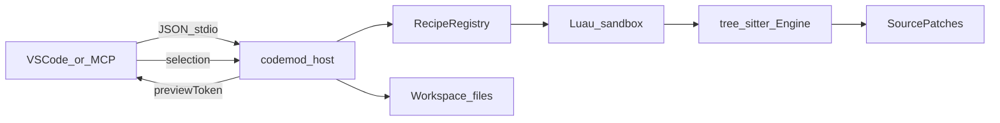

# Getting Started with Codemod Recipe

A human-oriented walkthrough of the product: what it is, how the pieces fit
together, and how to run your first recipe. Deep reference stays in the linked
topic docs — this guide is the map and the day-1 path.

To **write** recipes (query / capture / anchor, host API): [writing-recipes.md](writing-recipes.md).
For a full documentation index, see [README.md](README.md) in this folder.

## What you’re getting

**codemod-recipe** applies deterministic, AST-safe edits from **sandboxed Luau
recipes**. Each recipe is a module that `return`s metadata plus an `apply(c)`
function. Edits use tree-sitter queries (`c:insert` / `c:replace` / `c:remove`), so the same
recipe + args + file contents produce the same patches every time.

Everything runs through a **Rust host** (`codemod_host`). Two clients talk to it:

| Client | Best for |
|--------|----------|
| **VS Code / Codium extension** | Interactive preview, Files + Transcript review, selective patches |
| **MCP server** (`codemod_mcp`) | Agents (Cursor, etc.) calling validate → preview → apply |



The golden rule: **preview before apply**. The host returns a `previewToken`
(recipe + args + starting file hashes); apply requires that token (and may include
a patch selection).

Languages: Dart is the default. Rust, Java, Kotlin, SQL/SQLite, and 300+ grammars
are available via tree-sitter — set `language` on edit ops for non-Dart files.

## Where documentation lives

Three layers exist on purpose. Humans and agents use different ones.

| Layer | Location | Audience |
|-------|----------|----------|
| **Human docs** | `docs/`, root and extension READMEs | You — tutorials and reference |
| **Agent skills** | `.agents/skills/` after bootstrap; source of truth `export/.agents/skills/` | Cursor / MCP agents |
| **Rules** | `.cursor/rules/` | Always-on agent policy — not a human manual |

Human docs in this repository are **not** copied by `bootstrap_project`. Agent
skills and rules are. See the [docs index](README.md) for every topic page.

## Pick a path

Both paths share the same engine and Luau recipe format. Choose by how you want to work:

- **VS Code (recommended for learning)** — browse recipes, fill a form, review
  diffs (Files + Transcript tabs), apply selected patches. Full setup:
  [vscode_extension/README.md](../vscode_extension/README.md).
- **MCP (recommended for agents)** — bootstrap skills, then validate / preview /
  apply from the agent. Path-specific guide:
  [new-project-rust-mcp.md](new-project-rust-mcp.md). Tool reference:
  [codemod-mcp.md](codemod-mcp.md).

You can use both against the same `.codemod/` directory.

## Setup (enough to succeed)

### Prerequisites

- A target workspace (the project you want to edit).
- [Rust](https://rustup.rs/) (stable) if you build the host or MCP from source.
- [Node.js](https://nodejs.org/) 18+ to build the VS Code extension.

### Workspace layout

In the target project:

```text
.codemod/
  recipes/     # Luau recipe modules (*.luau or *.lua)
  maps/        # Luau map modules (id + map table)
  variables/   # Luau variable modules (id + values table)
  queries/     # Luau query libraries (id + queries table)
  templates/   # optional (renderFileTemplate)
```

Discovery scans `.codemod/` for Luau modules that `return` the expected table shapes.

File-backed resources (`.scm` queries, template files, `postExecution` scripts)
resolve recipe-local first, then under `.codemod/`.

### VS Code extension

1. From this repo: `cd vscode_extension && ./build.sh` (bundles `codemod_host`).
2. Install the VSIX and open a workspace that has (or will have) `.codemod/`.
3. Use **Codemod Recipe: Scaffold Project** if `.codemod` is missing.
4. Open the **Codemod Recipe** activity bar: Recipes + Recipe Runner.

Details and settings: [vscode_extension/README.md](../vscode_extension/README.md).

**Review panel:** after preview, inspect **Files** (diffs) and **Transcript**
(every `c:` call, including postExec entries skipped on preview). When apply may
differ from preview because postExec was skipped, a small **applyMayDiverge**
disclaimer appears.

**Query Tools** (same Codemod activity bar: **Query AST** + **Query Tools**):

1. Open a source file, then browse or click an AST node to generate a starter query.
2. Paste or edit the query, set `capture` / `anchor`, and **Run** to highlight matches.
3. Use Query Tools to debug queries before embedding them in recipe Luau.

Walkthrough: [tree-sitter-queries.md — Query Tools](tree-sitter-queries.md#query-tools-vs-code).

### MCP

1. Build/run `codemod_mcp` pointing at your workspace root and `.codemod`.
2. Configure Cursor (or another MCP client) — see [codemod-mcp.md](codemod-mcp.md).
3. Call `bootstrap_project` once to install agent skills/rules and scaffolding.
4. End-to-end new-project checklist:
   [new-project-rust-mcp.md](new-project-rust-mcp.md).

Query debugging without the extension: MCP `dump_ast`, `debug_query`,
`generate_query`. Overview: [tree-sitter-queries.md](tree-sitter-queries.md#query-tools-vs-code).

## Core concepts

### Recipes

A recipe is a Luau module:

```lua
return {
  id = "add_log_line",
  name = "Add log line",
  args = {
    { name = "file", required = true, inputKind = "file" },
    { name = "className", required = true, inputKind = "symbol" },
    { name = "methodName", required = true, inputKind = "symbol" },
  },
  postExecution = { "dart format ." },
  apply = function(c)
    c:insert({
      path = c.args.file,
      query = [[
        (class_definition
          name: (identifier) @className
          body: (class_body
            (method_signature
              (function_signature
                name: (identifier) @methodName))
            (function_body
              (block) @body))
          (#eq? @className "]] .. c.args.className .. [[")
          (#eq? @methodName "]] .. c.args.methodName .. [["))
      ]],
      capture = "body",
      anchor = "end",
      text = "    print('codemod');\n",
    })
  end,
}
```

**`apply(c)` is the only mutation entrypoint.** Use Luau `if` / `for` in `apply` for
guards and idempotency.

#### How an insert finds its place

Three fields work together on `c:insert`:

1. **`query`** — tree-sitter pattern. Names like `@body` label matched nodes.
2. **`capture`** — which named match is the **edit target** (without `@`).
3. **`anchor`** — insert **before** (`start`) or **after** (`end`) that span:

```text
  …[===== @body span =====]…
     ^                     ^
  anchor: start         anchor: end
```

How to write recipes end to end: [writing-recipes.md](writing-recipes.md).
Query language detail: [tree-sitter-queries.md](tree-sitter-queries.md).

Optional `postExecution` (or `c:postExec` inside `apply`) runs shell commands after
a successful apply. Preview records these in the transcript but does not run them.

### Host API (summary)

| Method | Role |
|--------|------|
| `c.args` | Resolved recipe arguments |
| `c:insert` / `c:replace` / `c:remove` | AST patches |
| `c:query` / `c:read` | Read-only inspection |
| `c:create` / `c:delete` | File create/delete |
| `c:run(id, args?)` | Call another recipe |
| `c:postExec` | Shell command (apply only) |
| `c:applyTemplate` / `c:renderFileTemplate` | MiniJinja |
| `c:map` / `c:var` / `c:queryLib` | Registered assets |

Full API: [writing-recipes.md](writing-recipes.md) and skill `codemod-luau-recipes`.

### Preview vs apply

- **Preview** runs `apply()` against an in-memory **WorkingTree**; builds diffs + transcript.
- **Apply** **re-runs** `apply()` from original file hashes, flushes to disk, then runs postExec.
- **`previewToken`** binds recipe id/source, args, and starting file hashes.

### Tree-sitter queries

Ops find nodes with tree-sitter query S-expressions. Queries can be inline strings,
paths to `.scm` files, or ids from query libraries under `.codemod/queries/`.

Debug with **Query Tools** (VS Code) or MCP `dump_ast` / `debug_query` before
`preview_recipe`.

### Templates (MiniJinja)

String templating uses [MiniJinja](https://docs.rs/minijinja/) via `c:applyTemplate`
and `c:renderFileTemplate` only.

```lua
local path = c:applyTemplate({ template = "lib/{{ feature | snake_case }}.dart" })
```

Full guide: [recipe-templates.md](recipe-templates.md).

### Maps, variables, and query libraries

Shared assets are Luau modules:

| Kind | Path | Return shape |
|------|------|--------------|
| Maps | `.codemod/maps/*.luau` | `{ id, map = { ... } }` |
| Variables | `.codemod/variables/*.luau` | `{ id, values = { ... } }` |
| Query libs | `.codemod/queries/*.luau` | `{ id, queries = { ... } }` |

Lookup in recipes: `c:map("id")`, `c:var("id")`, `c:queryLib("id")`.

### Composition

Call other recipes from `apply`:

```lua
c:run("dart.settings.add_counter_field")
c:run("dart.logging.add_log_line", { file = c.args.file })
```

Or pass a full module as MCP **`inlineRecipe`** (Luau source string, no file on disk).

### Languages

Default language is Dart. For other files, set `language = "rust"` (etc.) on the
edit spec. `.sql` defaults to `sqlite`.

Details: [language-support.md](language-support.md).

### Naming and design patterns

| Prefix | Purpose |
|--------|---------|
| `create_` | Greenfield files from templates |
| `add_` / `patch_` | Brownfield AST edits (one change each) |
| `scaffold_` | Feature workflow (`c:run` atomics) |
| `remove_` | Tear down members or files |

**One recipe = one coherent change.** Summary: [recipe-design-patterns.md](recipe-design-patterns.md).

## Day-1 success: run a recipe

### In VS Code

1. Open **Codemod Recipe** → pick a recipe in the **Recipes** tab.
2. Fill args in **Recipe Runner** (live preview updates as you type).
3. Review **Files** and **Transcript**; uncheck anything you do not want.
4. **Apply Selected**.

Arg defaults use `defaultsTo`. Power features: [recipe-shortcuts.md](recipe-shortcuts.md).

### Over MCP

Typical tool order:

1. `bootstrap_project` (once, if needed)
2. `validate_recipes` (after editing Luau)
3. `list_recipes` / `describe_recipe`
4. `preview_recipe` — save `previewToken`
5. `apply_recipe` with the same recipe/args + token

Re-preview afterward: an idempotent recipe returns no files.
More detail: [codemod-mcp.md](codemod-mcp.md).

## Optional companion: codebase-memory

For large codebases, [codebase-memory-mcp](https://github.com/DeusData/codebase-memory-mcp)
helps locate symbols and impact **before** you write or choose a recipe.

## What agents use (you don’t need to memorize)

After `bootstrap_project`, agents get modular skills under `.agents/skills/`
(`codemod-luau-recipes`, `codemod-mcp-playbook`, and others) plus an always-on rule.
Prefer this guide and the topic docs when learning yourself.

## Next steps

| Goal | Go to |
|------|-------|
| Docs map (everything) | [docs/README.md](README.md) |
| **Write a recipe** | [writing-recipes.md](writing-recipes.md) |
| Host API reference | skill `codemod-luau-recipes` → `reference.md` |
| Extension UI & settings | [vscode_extension/README.md](../vscode_extension/README.md) |
| New project + MCP | [new-project-rust-mcp.md](new-project-rust-mcp.md) |
| Jinja / templates | [recipe-templates.md](recipe-templates.md) |
| Queries / Query Tools | [tree-sitter-queries.md](tree-sitter-queries.md#query-tools-vs-code) |
| Multi-language | [language-support.md](language-support.md) |
| Shortcuts / slots | [recipe-shortcuts.md](recipe-shortcuts.md) |
| Architecture | [ARCHITECTURE.md](../ARCHITECTURE.md) |
| Contributing | [CONTRIBUTING.md](../CONTRIBUTING.md) |
