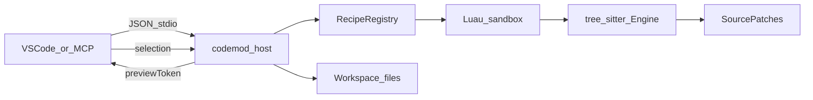

# What you’re getting

**codemod-recipe** applies deterministic, AST-safe edits from **sandboxed Luau
recipes**. Each recipe is a module that `return`s metadata plus an `apply(c, args)`
function. Edits use tree-sitter queries (`c:insert` / `c:replace` / `c:remove`), so the same
recipe + args + file contents produce the same patches every time.

Everything runs through a **Rust host** (`codemod_host`). Two clients talk to it:

| Client | Best for |
|--------|----------|
| **VS Code / Codium extension** | Interactive preview, Files + Transcript review, selective patches |
| **MCP server** (`codemod_mcp`) | Agents (Cursor, etc.) calling validate → preview → apply |

The golden rule: **preview before apply**. The host returns a `previewToken`
(recipe + args + starting file hashes); apply requires that token (and may include
a patch selection).

Languages: Dart is the default. Rust, Java, Kotlin, SQL/SQLite, and 300+ grammars
are available via tree-sitter — set `language` on edit ops for non-Dart files.
