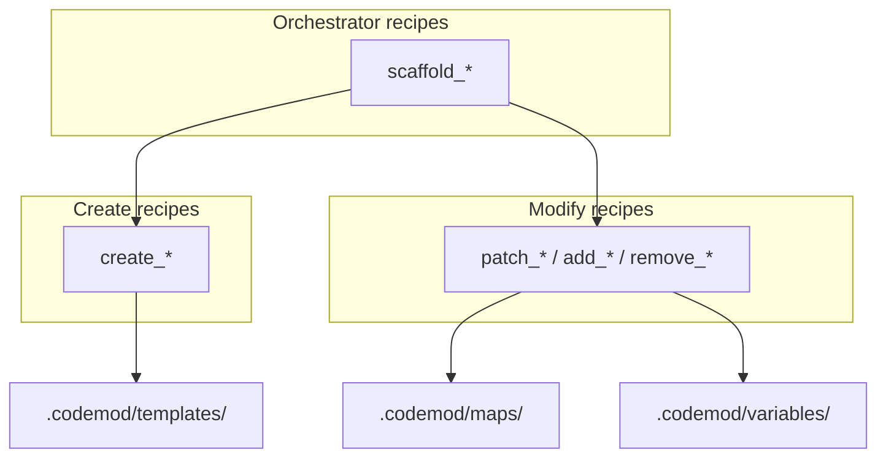

# Mental model

Think in three layers:

1. **Atomic recipes** — one coherent change (create one file, add one field, remove one member).
2. **Orchestrator recipes** — compose atomics into a feature-level workflow.
3. **Shared assets** — templates, maps, and variables reused across recipes.

**One recipe = one coherent change**, composed upward for features. Host API:
[host-api.md](../../02_writing_recipes/02_host_api/00_index.md).
