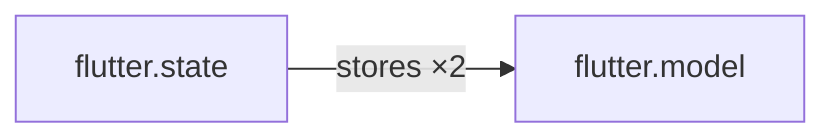

# Relations

Relations are **first-class edges between component instances**, derived from code by a
post-scan `relate` hook and judged by a graph-aware `verify`. They replace ad-hoc
nesting or filename conventions when the link between two things is itself a fact worth
checking ("this store stores that model", "this repository implements that interface").

Scan phase order: `identify → parse (all roots) → relate (all instances) → verify (all
instances)`. `parse` stays pure — it extracts local facts including references-by-name
(`modelId = "recipe"`, a constructor param type); `relate` turns those names into edges.

## The `relate` hook

```lua
relate = function(c, instance, index)
  return {
    kind = "stores",                                          -- required, open vocabulary
    to = { componentId = "flutter.model", key = instance.ast.modelId },
    source = instance.ast.source,                             -- provenance (span optional)
    cardinality = "one",                                      -- extra fields pass through
  }
end
```

- Runs **after the full scan forest is built** — forward references and cycles are
  fine by construction. Walks every instance including nested children.
- Returns one edge table, an array of edges, or `nil`.
- `from` defaults to the relating instance; set it explicitly only for third-party
  (glue) edges, e.g. a DI-container component emitting `depends_on` between two other
  instances.
- The host collects, resolves, and **merges** duplicates by `(from, kind, target)`
  into one canonical edge, then indexes all edges.

### Target forms (`to`)

| Form | Resolution |
|------|-----------|
| `"componentId/key"` string | Exact flat instance id. Unknown → `relation.unresolved` finding |
| `{ componentId = "...", key = "..." }` | Ref; host resolves to `componentId/key` or an instance of that component whose `ast.id` equals `key`. Unresolved → `relation.unresolved` finding (**drift signal**) |
| `{ symbol = "dart:core/StatelessWidget" }` | External target (SDK classes etc.); never resolves, never a finding |

Alternatively, look targets up yourself via `index` when the mapping is
project-specific (DI registrations, naming conventions the host can't know) and emit
an exact id.

### Duplicate edges merge

Edges are facts, not events: re-deriving the same fact must not create a second edge.
Duplicates by `(from, kind, target)` — **kind is part of the key**, so the same pair
linked by two kinds is two edges — merge into one canonical edge:

- The edge always carries `sources` — a **list** of every distinct derivation
  (`{ path, span? }`), even when there is just one. Multiplicity is `#sources`; there
  is no stored `count`. Extra fields stay first-wins.
- Distinct provenance (two call sites derive the same edge) merges silently.
- Identical provenance (same file+span emitted twice) means redundant `relate`
  output → one `relation.duplicate` **info** finding per canonical edge.

## Facades

`index` (relate phase) is the forest **before** edges; `graph` (verify phase,
operations, scaffold) is the forest **plus** resolved edges. Both always cover the
full forest. Vocabulary: instances are the graph **nodes**, relations are **edges**.

| `index` | Returns |
|---------|---------|
| `index:byId(id)` | Node or `nil` |
| `index:byComponent(componentId)` | Array of nodes |
| `index:nodes()` | All nodes (flat array) |

| `graph` (all index methods, plus) | Returns |
|-----------------------------------|---------|
| `graph:edges()` | All resolved edges |
| `graph:outgoing(id, kind?)` | Edges whose `from == id` |
| `graph:incoming(id, kind?)` | Edges whose `to == id` |
| `graph:resolve(edge)` | Target node (`edge.to`) or `nil` |
| `graph:resolveFrom(edge)` | Source node (`edge.from`) |
| `graph:reachable(fromId, kind?)` | Set `{ [id] = true }` via BFS over outgoing edges |

Nodes returned by the graph facade (`byId`, `resolve*`, `nodes()`) — including the
`instance` a hook is called with — carry **node-centric traversal** methods, so most
checks read without id plumbing:

| `node:*` | Returns |
|----------|---------|
| `node:outgoing(kind?)` | `graph:outgoing(node.id, kind)` |
| `node:incoming(kind?)` | `graph:incoming(node.id, kind)` |
| `node:follow(edge)` | The other endpoint (`nil` for external symbol targets) |
| `node:neighbors(kind?)` | Deduped adjacent nodes, both directions |

Nodes are `{ id, componentId, locator, ast, parentId, rootId }` — `ast` is the
parse-hook payload, so `graph:byId(id).ast.fields` etc. work as expected. All facade
queries read the same in-sandbox tables: no query is "more expensive" than another —
the cost is one JSON→Luau conversion at facade construction, regardless of how much
data a query touches.

## Graph-aware `verify`

`verify(c, instance, graph)` judges with relational context. Rules are ordinary Luau
judgment owned by the constrained component — there is no rule table; a "rule" is
reified only as a finding `code` when violated.

```lua
verify = function(c, instance, graph)
  local findings = {}
  local stores = instance:incoming("stores")
  if #stores == 0 then
    findings[#findings + 1] = { severity = "warning", code = "model.missing_store",
      message = "model has no store", instanceId = instance.id }
    return findings
  end
  local store = instance:follow(stores[1]) -- incoming edge: other endpoint = the store
  -- cross-check store.ast.fields against own children …
  return findings
end
```

The same judgment doubles as **operation guards**: `operations.*.apply(c, args,
target, graph)` receives the graph as 4th arg and can `error(...)` on illegal
requests — rejected at dry-run, before any diff. `scaffold.apply(c, args, graph)`
receives it as 3rd arg.

The graph is a **pre-operation snapshot**: it reflects the workspace as of the last
scan and judges the *request* — it does not observe edits made mid-`apply`. The
post-operation rescan produces the fresh graph (and fresh findings).

## Scan output

`component_scan` responses gain two fields, and instance nodes gain `relations`:

```json
{
  "instances": [ ... ],
  "edges": [ { "from": "flutter.state/recipe", "kind": "stores", "to": "flutter.model/recipe", "sources": [ { "path": "..." } ] } ],
  "kindGraph": [ { "from": "flutter.state", "kind": "stores", "to": "flutter.model", "count": 2 } ],
  "findings": [ ... ]
}
```

- `ast.relations` = outgoing edges grouped by kind (`{ "stores": [ { "to": ... } ] }`),
  so instance trees stay self-contained for agents.
- `kindGraph` is a **pure aggregation** over resolved edges by `(fromComponentId,
  kind, toComponentId)` with `count` — the derived architecture graph. External-symbol
  edges aggregate with `external = true`. Trustworthiness is proportional to modeled
  coverage; pair with `component_coverage` when interpreting it.

## Exporting the graph (mermaid)

`component_graph` renders the relations graph as **mermaid text** — paste it into any
mermaid renderer (mdBook docs render it inline), diff it in reviews, or hand it to an
agent as architectural context. Scan-on-demand: runs a scan first when the cache is
empty.

| `level` | Output |
|---------|--------|
| `kinds` (default) | Kind-level roll-up from `kindGraph`: one line per `(fromComponent, kind, toComponent)` with `×count` labels; external symbols marked `(external)`. Stack `relations` kinds with `layout = "member"` are omitted from this roll-up. |
| `instances` | Connected nodes only (omit isolates); architecture edges as arrows; `layout = "member"` kinds become nested mermaid subgraphs keyed by opaque string targets. Response also includes the resolved `edges` payload. |

Kind-level output for the flutter_poc fixture (two stores linked to their models):



An external-symbol edge renders with an `(external)` target label, e.g.
`rel_store["rel.store"] -- "extends ×2" --> dart_core_Store["dart:core/Store (external)"]`.

## Membership parents and zones

Kinds with `layout = "member"` (typically `lives_in`) build a **membership forest**:
child instance → opaque string subgraph key. The key may be:

| Parent form | Mermaid / metrics |
|-------------|-------------------|
| Another **instance id** (e.g. `repo.zone/rust.runtime`) | Nestable subgraph; metrics can resolve zone roles |
| Free-string / `{ symbol = "…" }` with no matching instance | Label-only box (no zone node, no `ZoneRole` flags) |

**Zones** (`stack.zones` + `repo.zone`) turn those labels into real instances so
membership can nest and roles can drive snapshot metrics:

- Catalog on the stack; `repo.zone` identifies one locator per entry
- Others `lives_in` → `"repo.zone/<id>"` (exact instance id)
- Optional `parentId` on a zone nests zone→zone
- `role` is a free string; metric behavior only if that string appears in
  `stack.zoneRoles` (see [stack manifest](../02_stacks/01_required_manifest.md))
- Role **without** a `zoneRoles` entry = title/grouping only

## Snapshot relation metrics

`persist_scan_snapshot` always writes a `relations` block (even when `codebase` is
empty): aggregate connectivity, `relationIgnored` (under `ignoreRelations` zones),
`architectureIsolated`, ratios, plus `byComponent` / `byKind` roll-ups. Omit giant
per-instance dumps — the edge list is already in the snapshot.

## Helper-library pattern

There is no generic relation-definition engine: detection needs conditionals,
iteration, and queries, so components own `relate`. Shared detection logic
(implements-clause edges, property-type → `cardinality` edges per language,
convention edges) and generic check algorithms (`no_cycles`, `at_least_one`) go into
`require`-able Luau helper libraries under `.codemod/lib/` — id-less modules are
already libraries.

## Notes

- n:m is **not** an edge type — it is a graph pattern (mutual many-edges or a junction
  instance) interpreted by verify judgment. Cardinality is edge metadata
  (`cardinality = "one" | "many"` from property type syntax).
- "is-a" splits: component-kind membership is free (`componentId` IS the type, no
  edge); `implements`/`extends` to scanned instances are edges; `extends` to SDK
  classes are external-symbol edges.
- Incremental scans re-run `relate` + `verify` over the merged forest (cached +
  reparsed roots): a dirty file can change edges between otherwise unchanged
  instances.
- Membership-implied constraints ("all widgets extend Widget") need no judgment —
  parse/non-match IS the verdict. Reserve `verify` for what parse successfully
  extracted, now including relational context.
