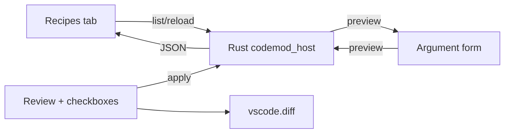

# Codemod Recipe — VS Code Extension

New here? Start with [Getting Started](../docs/usage/01_getting_started/00_index.md) for the full product walkthrough.

A GUI for the [`codemod_recipe`](../README.md) toolkit. Browse recipes, fill in
placeholder values through a form, preview changes as a native diff, and choose
exactly which edits to keep before applying. **Query Tools** (same sidebar)
lets you browse the AST, generate starter tree-sitter queries, and highlight
query matches before writing recipes. `*.test.luau` suites show up in the
native **Testing** view — grouped by suite id, runnable per test/suite/group,
with failures jumping to the failing line (see
[docs/testing](../docs/usage/07_testing/00_index.md)).

Supports **multi-language** recipes (Dart, Rust, Java, Kotlin, SQL, TypeScript,
JavaScript, Python, and 300+ tree-sitter grammars via the Rust host).

## How it works

The extension does not parse source files itself. It launches the **Rust
`codemod_host`** binary (tree-sitter engine) and talks to it over a
JSON-over-stdio protocol.



**Default:** bundled `codemod_host` from `vscode_extension/bin/` (built via
repo-root `./build.sh`). **Dev fallback:** `cargo run -p codemod_recipe_host
--bin codemod_host` when no binary is present.

## Setup

### Luau recipes

1. Create a `.codemod/` directory in your workspace root — or run
   **Codemod Recipe: Scaffold Project** (also offered when `.codemod` is missing).
2. Add Luau recipe modules (`.luau` or `.lua`) anywhere under `.codemod/`.
   Each recipe must `return { id, apply = function(c, args) ... end }`. The `.codemod/recipes/`
   directory is a convention; the registry identifies recipes by the `apply` function.
   Use dotted ids like `rust.data.add_log_line` to organize the Recipes tab tree.
3. Optionally add maps, variables, query libraries, and types as Luau modules anywhere under
   `.codemod/`. The subdirectories `.codemod/maps/`, `.codemod/variables/`, `.codemod/queries/`,
   and `.codemod/types/` are conventions; the registry identifies each asset by its returned
   table shape (`map`, `values`, `queries`, or `fields`). Add templates under `.codemod/templates/`.
4. Full product build from the repo root (`./build.sh`), or package only with
   `vscode_extension/build.sh` when `bin/codemod_host` is already present
   (`npm run compile` then package/install the VSIX for local iteration).
5. Open your project in VS Code and configure settings if needed:

```jsonc
// .vscode/settings.json
{
  "codemodRecipe.codemodRoot": ".codemod",
  "codemodRecipe.workspaceRoot": "",
  "codemodRecipe.autoPreviewDebounceMs": 400,
  "codemodRecipe.previewSnippetLines": 5
}
```

All `.luau`, `.lua`, `.template`, and `.scm` files under the codemod root are
automatically discovered and reloaded when changed (file-system watch plus reload
on editor save). Recipe load errors appear in the Recipes tab and the Problems
panel. Use **Re-scan recipes** only if the catalog looks stale after adding files
outside the watched patterns or after a host restart failure.

### Custom codemod root

To use a different directory than `.codemod`, set `codemodRecipe.codemodRoot` in
settings or use **Codemod Recipe: Set Codemod Root Directory**.

## Usage

1. Open the **Codemod Recipe** view in the activity bar. The side view has
   **Recipes** and **Recipe Runner** tabs.
2. Search or expand folders derived from dotted recipe ids in the **Recipes** tab, then click a recipe to
   open the runner. Right-click a recipe and choose **Show Recipe** when the host reports a `sourceFile`.
3. The **Recipe Runner** tab shows parameter metadata and runs live preview
   automatically as form values change.
4. The review panel shows changed files with short snippets and per-file/per-patch
   selection controls.
5. Use **Previous Change**, **Next Change**, or click a patch row to step through
   changes and open the native side-by-side diff for that file.
6. Uncheck any files or patches you do not want, then click **Apply Selected**.

### Keyboard shortcuts

Bind recipes to chords via **slots** (`codemodRecipe.slots`) or
`codemodRecipe.invoke`. Args can auto-fill from the editor with recipe `from:` /
`contextKey`. Full guide: [docs/recipe-shortcuts.md](../docs/usage/04_templates_and_patterns/03_recipe_shortcuts.md).

Explorer: right-click a file/folder → **Codemod Recipe ▸ Run Recipe Here…**
(auto-apply when args complete) or **Open in Recipe Runner…** for recipes that
declare `explorerMenu` (see the shortcuts doc).

Example workspace settings:

```jsonc
{
  "codemodRecipe.slots": {
    "1": "my.feature.recipe",
    "b": "flutter.add_bloc"
  }
}
```

Default chords: `Ctrl+Shift+I` then `1` (run/auto), `Ctrl+Shift+T` then `1` (open runner).

### Editor navigation (Recipe Language Toolkit)

Under `codemodRecipe.codemodRoot` (default `.codemod`) Luau/Lua recipe files get:

- **Completions** for `c:` methods, edit-spec keys, recipe ids (`id =` / `c:run`), map/var/query ids (`c:map` / `c:var` / `c:queryLib`), `language`, captures, `args.*` (from the open recipe’s `args` table), and nested `c:run` args
- **Go to Definition** on `c:run("recipe.id")`
- **Hover** on host methods and recipe refs
- **CodeLens** on top-level `id = "..."` (runner / keybinding / slot)
- **Diagnostics** from the Rust host validate of **saved** recipe files

Install **[Luau Language Server](https://marketplace.visualstudio.com/items?itemName=JohnnyMorganz.luau-lsp)** for typed `CodemodContext` via `.codemod/stubs/codemod-context.d.luau` (generated from annotated Rust handlers via `scripts/generate-host-api-surface.sh`, installed by Scaffold / bootstrap). The Codemod completion provider does **not** depend on that stub; luau-lsp does. Soft **Scaffold Project** skips existing files — use **Codemod Recipe: Update Project Scaffold** (confirm → bootstrap with `force: true`) after upgrading so the stub and other scaffold assets refresh. **Refresh Recipes** reloads the recipe catalog only.

Recipe authoring reference: [docs/writing-recipes.md](../docs/usage/02_writing_recipes/01_workflow.md) and [host-api.md](../docs/usage/02_writing_recipes/02_host_api.md).

You can also run **Codemod Recipe: Run From Cursor Context** (`Cmd+Alt+R` on
macOS, `Ctrl+Alt+R` elsewhere). Context keys include `file`, `selection`, `word`,
`dartClass`, and generic `className`.

**Codemod Recipe: Restart Host** restarts the Rust host process.
**Codemod Recipe: Scaffold Project** writes skills/rules and `.codemod/` scaffolding (skips existing).
**Codemod Recipe: Update Project Scaffold** force-updates those files (including `codemod-context.d.luau`).

## Protocol reference

Commands accepted by the host (one JSON object per line on stdin):

```jsonc
{ "command": "list" }

{ "command": "validate" }

{ "command": "bootstrap", "force": false }

{ "command": "preview", "recipe": "add_log_line",
  "args": { "file": "lib/foo.dart", "className": "Foo", "methodName": "bar" },
  "snippetLines": 5 }

{ "command": "diff", "recipe": "add_log_line", "path": "lib/foo.dart",
  "args": { "file": "lib/foo.dart", "className": "Foo", "methodName": "bar" } }

{ "command": "apply", "recipe": "add_log_line",
  "args": { "file": "lib/foo.dart", "className": "Foo", "methodName": "bar" },
  "previewToken": "<from preview>",
  "selection": { "files": { "lib/foo.dart": { "include": true } } } }

{ "command": "dumpAst", "path": "lib/foo.dart" }

{ "command": "debugQuery", "path": "lib/foo.dart",
  "query": "(identifier) @id", "instrument": true }

{ "command": "generateQuery", "path": "lib/foo.dart", "start": 10, "end": 20 }

{ "command": "resolveStaticPath", "pathTemplate": "lib/{{ file }}.dart" }

{ "command": "runTests", "filter": "flutter.model.tests/parses_fields" }
```

`list`/`reload` responses include `testSuites` (`id`, `target`, `path`,
`testNames`) for test discovery; `runTests` returns the per-test report
(`filter` is optional — omit to run everything).

Omitting a file from `selection.files` keeps it. Setting `include: false` drops the file.

## Development

```bash
cd vscode_extension
npm install
npm run compile          # build Vue webview + type-check extension to dist/
npm run watch            # rebuild extension host on change
npm run watch:webview    # rebuild webview UI (media/recipeView.js) on change
npm run test:webview     # unit tests for webview arg/selection helpers
../build.sh              # full product: surface gen + host + VSIX
./build.sh               # package VSIX only (requires bin/codemod_host)
```

The sidebar UI lives in [`src/webview/`](src/webview/) (Vue 3 + Vite) and compiles
into [`media/recipeView.js`](media/recipeView.js) and [`media/recipeView.css`](media/recipeView.css).
Shared message types and constants used by both the extension host and webview are in
[`src/shared/`](src/shared/). Run `npm run build:webview` (or full `npm run compile`) before `F5`
if you change webview sources.

The files in `media/` (`recipeView.html`, `recipeView.js`, `recipeView.css`) are
**built artifacts**: edit sources under `src/webview/`, then compile.

```bash
# Integration smoke test against the Rust host (requires cargo):
node scripts/smoke.mjs
```

Press `F5` in VS Code (with this folder open) to launch an Extension
Development Host for manual testing.

### Manual smoke checklist (webview)

1. Open **Codemod Recipe** — **Recipes** tab lists recipes from the host (grouped/searchable).
2. Select a recipe — **Recipe Runner** tab opens with the argument form.
3. Edit args — preview status updates; review panel appears when the host returns files.
4. **Previous Change** / **Next Change** — active patch highlights; native diff opens.
5. Toggle file/patch checkboxes — **Apply Selected** enables when preview is current.
6. **Browse…** on file/directory args — path fills in and preview re-runs.
7. Switch tabs — form values and review state persist (no full page reload).
